# Отчет по лабораторной работе №5 «Проектирование модели управления версиями ПО, конфигурациями и непрерывной поставкой»

**Выполнил(а):** Чжао Аофэй, группа 13
**Дисциплина:** Непрерывная интеграция и сборка программного обеспечения
**Вариант:** группа 13 — задания 1–2

## 1. Цель работы

Изучение решений для автоматизации управления инфраструктурой и установки приложений.

Задачи работы:

1. Установить и изучить применение Terraform.
2. Установить и изучить руководство по Ansible.
3. Продемонстрировать развертывание инфраструктуры из трёх виртуальных машин и кластера Kubernetes, установку необходимых приложений с использованием Terraform и Ansible.
4. Оформить отчёт в формате Markdown и создать Pull Request в git-репозитории.

Согласно критериям оценивания: «для групп 10–12 выполнить задания 1–3, для группы 13 — задания 1–2». В работе выполняются **задание 1** (Terraform, трек Get Started — Docker) и **задание 2** (Ansible: инвентарь, ad-hoc команды, playbooks).

## 2. Задание 1. Основы управления конфигурацией инфраструктуры с Terraform

### 2.1. Используемые версии

| Компонент | Версия |
|---|---|
| Terraform CLI | v1.9.8 (linux_amd64, официальный образ `hashicorp/terraform:1.9`) |
| Провайдер `kreuzwerker/docker` | v4.6.0 |
| Docker / Docker Compose | 29.8.0 / v5.5.1 |

### 2.2. Особенность установки в текущем окружении

Официальные сайты `releases.hashicorp.com` и `registry.terraform.io` недоступны для
региона выполнения работы: запрос бинарника возвращает 404, а `terraform init`
завершается ошибкой `The host "registry.terraform.io" ... does not offer a
Terraform provider registry`. Поэтому Terraform запускается из официального
образа Docker Hub (`hashicorp/terraform:1.9`), а провайдер заранее укладывается
в локальное зеркало внутри образа (файл `Dockerfile`, конфигурация `terraformrc`):

```dockerfile
FROM hashicorp/terraform:1.9

RUN apk add --no-cache curl unzip && \
    mkdir -p /plugins/registry.terraform.io/kreuzwerker/docker/4.6.0/linux_amd64 && \
    curl -fsSL -o /tmp/provider.zip \
      "https://github.com/kreuzwerker/terraform-provider-docker/releases/download/v4.6.0/terraform-provider-docker_4.6.0_linux_amd64.zip" && \
    unzip -q /tmp/provider.zip -d /plugins/registry.terraform.io/kreuzwerker/docker/4.6.0/linux_amd64

COPY terraformrc /root/.terraformrc
```

```hcl
provider_installation {
  filesystem_mirror {
    path    = "/plugins"
    include = ["registry.terraform.io/*/*"]
  }
  direct {
    exclude = ["registry.terraform.io/*/*"]
  }
}
```

Запуск выполняется обёрткой `tf.cmd` (проброс рабочего каталога и сокета Docker):

```bat
docker run --rm -v "%CD%:/workspace" -v /var/run/docker.sock:/var/run/docker.sock -w /workspace lab5-terraform %*
```

```text
$ tf version
Terraform v1.9.8
on linux_amd64
+ provider registry.terraform.io/kreuzwerker/docker v4.6.0
```

### 2.3. Руководство 1. What is Infrastructure as Code with Terraform

Инфраструктура описывается декларативно в файлах HCL, которые хранятся в системе
контроля версий. Terraform сравнивает желаемое состояние (конфигурация),
записанное состояние (`terraform.tfstate`) и реальную инфраструктуру, строит план
изменений и применяет его. В работе инфраструктурой является Docker-контейнер
nginx: он описан кодом, а не создаётся вручную командой `docker run`.

### 2.4. Руководство 2. Install Terraform

Установка выполнена способом, описанным в п. 2.2 (образ Docker с CLI Terraform).
Проверка: `tf version` (см. выше).

### 2.5. Руководство 3. Build infrastructure

Конфигурация состоит из четырёх файлов.

`terraform.tf` — версия Terraform и источник провайдера:

```hcl
terraform {
  required_version = ">= 1.5"

  required_providers {
    docker = {
      source  = "kreuzwerker/docker"
      version = "4.6.0"
    }
  }
}
```

`main.tf` — провайдер и два ресурса (образ и контейнер):

```hcl
provider "docker" {
  host = "unix:///var/run/docker.sock"
}

resource "docker_image" "nginx" {
  name         = var.image_name
  keep_locally = false
}

resource "docker_container" "nginx" {
  name  = var.container_name
  image = docker_image.nginx.image_id

  ports {
    internal = var.internal_port
    external = var.external_port
  }
}
```

Инициализация, форматирование и проверка:

```text
$ tf init
Initializing provider plugins...
- Installed kreuzwerker/docker v4.6.0 (unauthenticated)
Terraform has been successfully initialized!

$ tf fmt -check
$ tf validate
Success! The configuration is valid.
```

Планирование и применение:

```text
$ tf plan
Plan: 2 to add, 0 to change, 0 to destroy.

Changes to Outputs:
  + container_id   = (known after apply)
  + container_name = "lab5-nginx"
  + url            = "http://localhost:8000"

$ tf apply -auto-approve
docker_image.nginx: Creating...
docker_image.nginx: Creation complete after 7s [id=sha256:65645c7b...nginx:1.27-alpine]
docker_container.nginx: Creating...
docker_container.nginx: Creation complete after 1s [id=e3c04790b273e561ad2d8bedc47a9302f86186c718a84ed62addccff704b9694]

Apply complete! Resources: 2 added, 0 changed, 0 destroyed.

Outputs:

container_id = "e3c04790b273e561ad2d8bedc47a9302f86186c718a84ed62addccff704b9694"
container_name = "lab5-nginx"
url = "http://localhost:8000"
```

Проверка результата:

```text
$ docker ps --filter name=lab5-nginx
lab5-nginx   65645c7bb6a0   0.0.0.0:8000->80/tcp

$ curl http://localhost:8000/
<!DOCTYPE html>
<html>
<head>
<title>Welcome to nginx!</title>
```

### 2.6. Руководство 4. Change infrastructure

Внешний порт изменён с 8000 на 8001 через переменную. Порт контейнера нельзя
изменить «на месте», поэтому Terraform удалил старый контейнер и создал новый:

```text
$ tf apply -auto-approve -var="external_port=8001"
docker_container.nginx: Destroying... [id=e3c04790b273e561ad2d8bedc47a9302f86186c718a84ed62addccff704b9694]
docker_container.nginx: Destruction complete after 1s
docker_container.nginx: Creating...
docker_container.nginx: Creation complete after 1s [id=3669928e2736c36590e47505fddf8d36a484ab9e4350dbce33bbd62f339f2e18]

Apply complete! Resources: 1 added, 0 changed, 1 destroyed.

Outputs:

url = "http://localhost:8001"
```

```text
$ curl -o /dev/null -w "%{http_code}" http://localhost:8001/
200
```

### 2.7. Руководство 5. Destroy infrastructure

```text
$ tf destroy -auto-approve
docker_container.nginx: Destroying... [id=3669928e...]
docker_container.nginx: Destruction complete after 0s
docker_image.nginx: Destroying... [id=sha256:65645c7b...]
docker_image.nginx: Destruction complete after 1s

Destroy complete! Resources: 2 destroyed.
```

После выполнения команды контейнер и образ, созданные Terraform, удалены;
`docker ps -a` не содержит `lab5-nginx`.

### 2.8. Руководство 6. Define input variables

Входные переменные вынесены в `variables.tf`:

```hcl
variable "container_name" {
  description = "Имя создаваемого контейнера"
  type        = string
  default     = "lab5-nginx"
}

variable "image_name" {
  description = "Образ Docker"
  type        = string
  default     = "nginx:1.27-alpine"
}

variable "external_port" {
  description = "Порт на хосте, на который публикуется контейнер"
  type        = number
  default     = 8000
}

variable "internal_port" {
  description = "Порт внутри контейнера"
  type        = number
  default     = 80
}
```

Значения можно задавать четырьмя способами, как в руководстве: значением по
умолчанию, флагом `-var`, файлом `terraform.tfvars` или переменной окружения
`TF_VAR_external_port`. В работе использован флаг `-var` (п. 2.6).

### 2.9. Руководство 7. Query data with outputs

Выходные значения описаны в `outputs.tf`:

```hcl
output "container_id" {
  description = "Идентификатор созданного контейнера"
  value       = docker_container.nginx.id
}

output "container_name" {
  description = "Имя контейнера"
  value       = docker_container.nginx.name
}

output "url" {
  description = "Адрес, по которому доступен контейнер"
  value       = "http://localhost:${var.external_port}"
}
```

```text
$ tf output
container_id = "e3c04790b273e561ad2d8bedc47a9302f86186c718a84ed62addccff704b9694"
container_name = "lab5-nginx"
url = "http://localhost:8000"

$ tf state list
docker_container.nginx
docker_image.nginx
```

### 2.10. Файл состояния

После `apply` в каталоге появился `terraform.tfstate` — JSON-файл, в котором
Terraform хранит соответствие ресурсов конфигурации реальным объектам Docker
(идентификаторы, атрибуты, зависимости). Именно по нему строится план: команда
`tf plan` сравнивает конфигурацию и состояние и показывает, что нужно изменить.

## 3. Задание 2. Управление конфигурацией серверов с помощью Ansible

### 3.1. Управляемые узлы и способ подключения

Управляемые узлы — три узла кластера Kubernetes из лабораторной работы 4
(кластер kind `lab4`). Узлы kind являются контейнерами Docker, поэтому в
инвентаре указан connection-плагин `community.docker.docker` (аналог SSH для
виртуальных машин; для реальных ВМ достаточно заменить его на `ssh`).

`inventory.ini`:

```ini
[kubernetes_nodes]
control_plane ansible_host=lab4-control-plane
worker1       ansible_host=lab4-worker
worker2       ansible_host=lab4-worker2

[kubernetes_nodes:vars]
ansible_connection=docker
ansible_python_interpreter=/usr/bin/python3

[all_nodes:children]
kubernetes_nodes
```

Проверка инвентаря:

```text
$ ansible-inventory -i inventory.ini --list
{
    "_meta": {
        "hostvars": {
            "control_plane": {"ansible_connection": "docker", "ansible_host": "lab4-control-plane", ...},
            "worker1": {...},
            "worker2": {...}
        }
    },
    "all_nodes": {"children": ["kubernetes_nodes"]},
    "kubernetes_nodes": {"hosts": ["control_plane", "worker1", "worker2"]}
}
```

### 3.2. Подготовка узлов

В минимальных узлах kind отсутствует Python, необходимый модулям Ansible,
поэтому сначала используется модуль `raw` (не требует Python на целевом узле):

```text
$ ans all -i inventory.ini -m raw -a "apt-get update -qq && apt-get install -y -qq python3"
control_plane | CHANGED | rc=0 >>
...
worker1 | CHANGED | rc=0 >>
...
worker2 | CHANGED | rc=0 >>
...
```

### 3.3. Ad-hoc команды

Проверка связи с группой узлов одной командой:

```text
$ ans all -m ping
worker1 | SUCCESS => {
    "changed": false,
    "ping": "pong"
}
worker2 | SUCCESS => {
    "changed": false,
    "ping": "pong"
}
control_plane | SUCCESS => {
    "changed": false,
    "ping": "pong"
}
```

Установка пакета `zsh` на все узлы:

```text
$ ans all -m apt -a "name=zsh state=present"
...
"Setting up zsh (5.9-8+b24) ..."

$ ans all -m command -a "zsh --version"
worker1 | CHANGED | rc=0 >>
zsh 5.9 (x86_64-debian-linux-gnu)
...
```

### 3.4. Playbook `site.yml`

```yaml
- name: Базовая настройка узлов кластера
  hosts: kubernetes_nodes
  gather_facts: true

  vars:
    packages: [zsh, curl, git, htop, vim]

  tasks:
    - name: Обновить кэш пакетов apt
      ansible.builtin.apt:
        update_cache: true
        cache_valid_time: 3600

    - name: Установить набор пакетов
      ansible.builtin.apt:
        name: "{{ packages }}"
        state: present
      notify: Проверить motd после установки

    - name: Проверить версию zsh
      ansible.builtin.command: zsh --version
      register: zsh_version
      changed_when: false

    - name: Показать версию zsh
      ansible.builtin.debug:
        msg: "{{ inventory_hostname }}: {{ zsh_version.stdout }}"

    - name: Разложить /etc/motd из шаблона Jinja2
      ansible.builtin.template:
        src: templates/motd.j2
        dest: /etc/motd
        mode: "0644"

    - name: Сделать zsh оболочкой по умолчанию для root
      ansible.builtin.user:
        name: root
        shell: /usr/bin/zsh

  handlers:
    - name: Проверить motd после установки
      ansible.builtin.command: cat /etc/motd
      changed_when: true
```

Результат выполнения:

```text
TASK [Вывести содержимое /etc/motd] ********************************************
ok: [control_plane] => {
    "msg": [
        "Узел кластера: control_plane",
        "Операционная система: Debian 13.6",
        "Ядро: 6.18.33.2-microsoft-standard-WSL2",
        "Адрес: lab4-control-plane",
        "Управляется через Ansible, группа: all_nodes, kubernetes_nodes"
    ]
}
...
RUNNING HANDLER [Проверить motd после установки] *******************************
changed: [control_plane]
changed: [worker1]
changed: [worker2]

PLAY RECAP *********************************************************************
control_plane              : ok=10   changed=4    unreachable=0    failed=0    skipped=0
worker1                    : ok=10   changed=4    unreachable=0    failed=0    skipped=0
worker2                    : ok=10   changed=4    unreachable=0    failed=0    skipped=0
```

### 3.5. Playbook `packages.yml` (цикл и регистрация результата)

```text
TASK [Установить пакеты по одному] *********************************************
changed: [control_plane] => (item=htop)
changed: [control_plane] => (item=vim)
changed: [control_plane] => (item=tree)
...
TASK [Показать, что изменилось] ************************************************
ok: [worker2] => (item=tree) => {"msg": "tree: changed=True"}
ok: [worker2] => (item=vim)  => {"msg": "vim: changed=False"}

PLAY RECAP *********************************************************************
control_plane              : ok=3    changed=1    unreachable=0    failed=0
worker1                    : ok=3    changed=1    unreachable=0    failed=0
worker2                    : ok=3    changed=1    unreachable=0    failed=0
```

Повторный запуск демонстрирует идемпотентность: уже установленные пакеты
(`vim`, `htop`) дают `changed=False`.

### 3.6. Playbook `demo.yml` (переменные, факты, условия, register, copy)

```text
TASK [Задача только для worker1 (условие when)] ********************************
skipping: [control_plane]
skipping: [worker2]
ok: [worker1] => {"msg": "Эта задача выполняется только на worker1"}

TASK [Вывести содержимое отчёта] ***********************************************
ok: [control_plane] => {
    "msg": [
        "host: control_plane",
        "os: Debian 13.6",
        "kernel: 6.18.33.2-microsoft-standard-WSL2",
        "python: 3.13.5"
    ]
}

PLAY RECAP *********************************************************************
control_plane              : ok=6    changed=1    skipped=1
worker1                    : ok=7    changed=1    skipped=0
worker2                    : ok=6    changed=1    skipped=1
```

## 4. Скриншоты

- `images/01-structure.png` — структура репозитория;

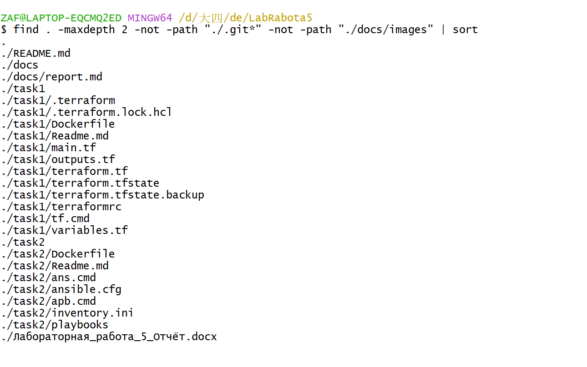
- `images/02-tf-version.png` — `tf version` (Terraform v1.9.8, провайдер docker v4.6.0);

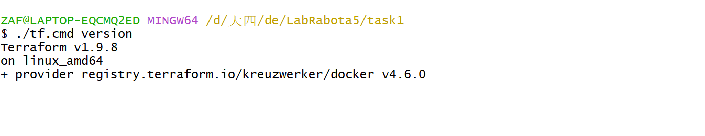
- `images/03-tf-code.png` — `main.tf` и `variables.tf`;

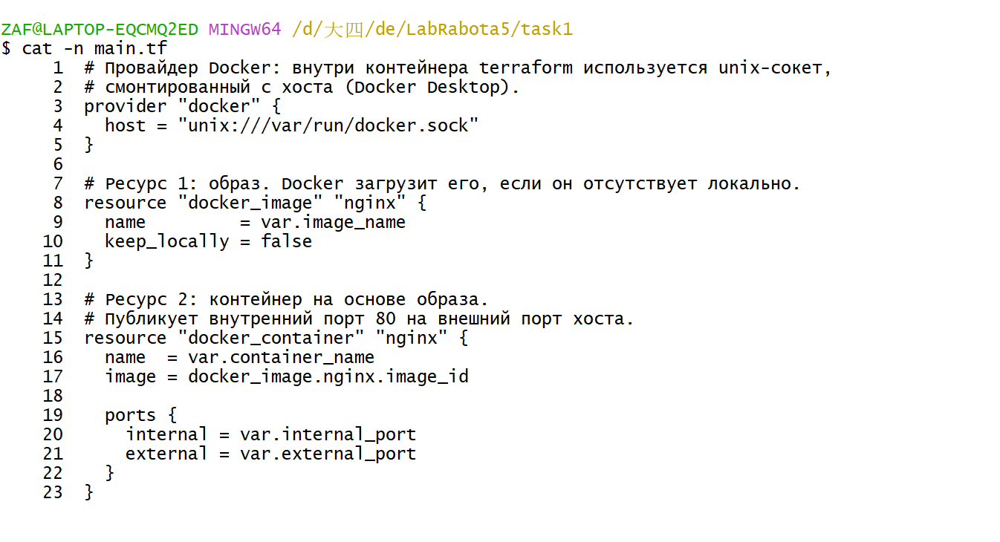
- `images/04-tf-init.png` — `tf init`;

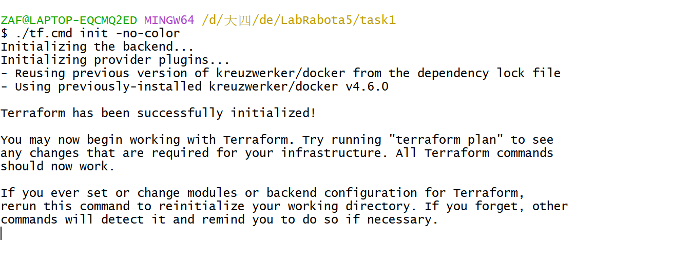
- `images/05-tf-plan.png` — `tf plan` (2 to add);

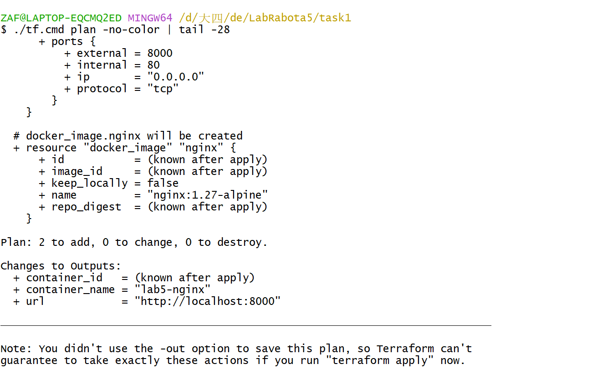
- `images/06-tf-apply.png` — `tf apply` и outputs;

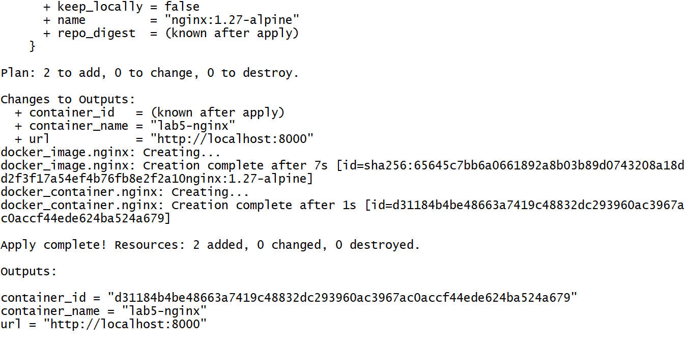
- `images/07-nginx.png` — контейнер в `docker ps` и страница nginx в браузере;

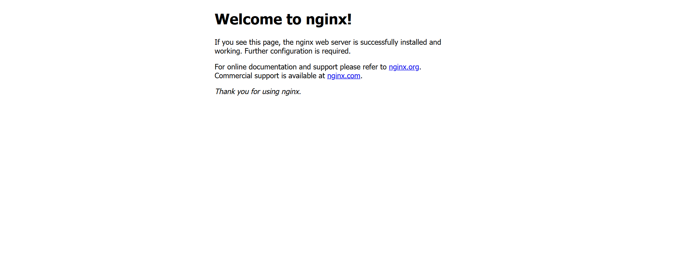
- `images/08-tf-state.png` — `tf output` и `tf state list`;

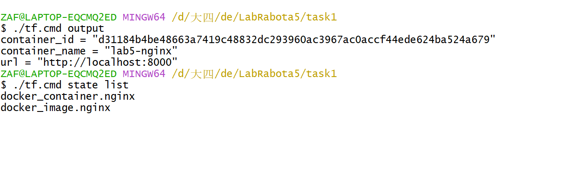
- `images/09-tf-change.png` — изменение порта (`-var external_port=8001`);

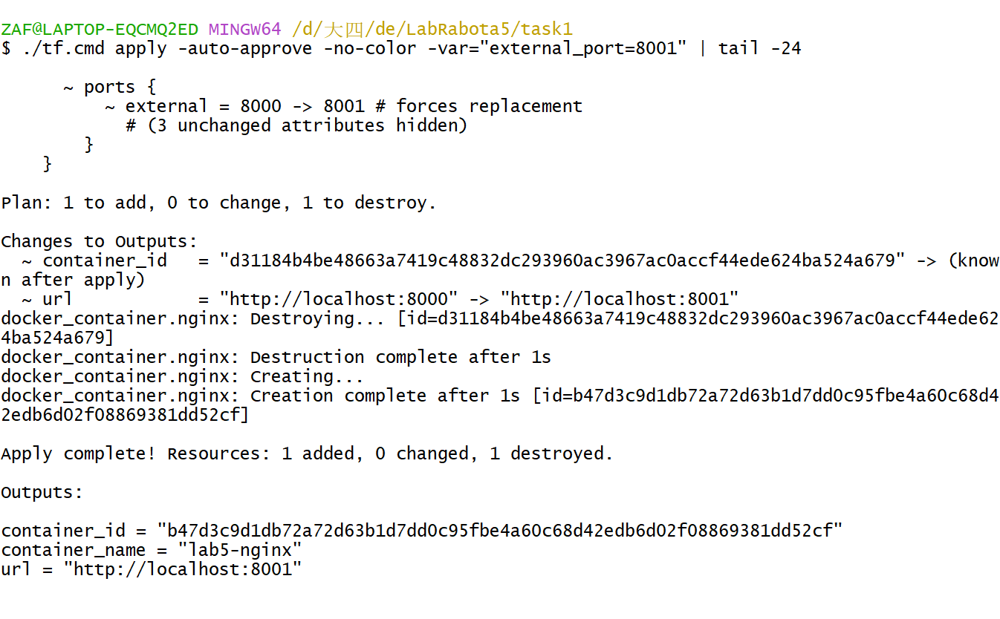
- `images/10-tf-destroy.png` — `tf destroy`;

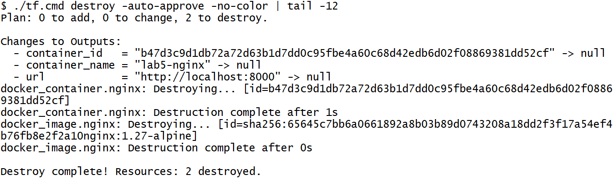
- `images/11-inventory.png` — `inventory.ini`;

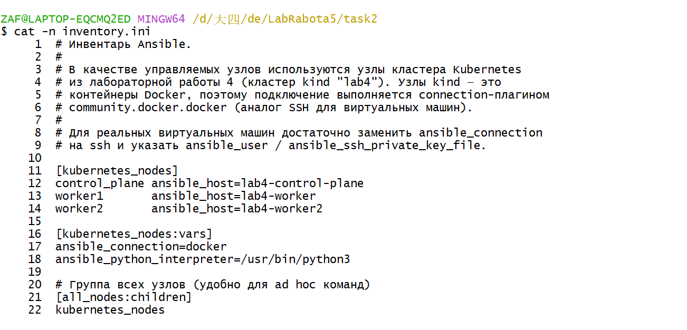
- `images/12-ans-ping.png` — `ans all -m ping` (pong от трёх узлов);

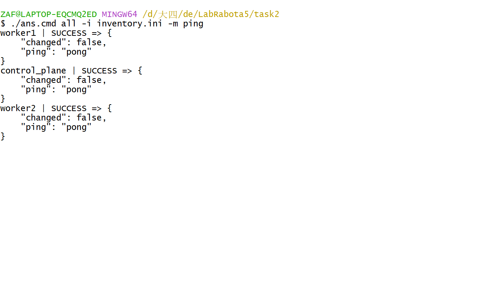
- `images/13-ans-zsh.png` — установка `zsh` ad-hoc командой и проверка версии;

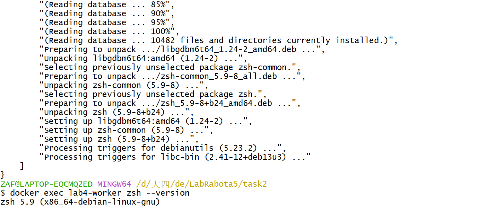
- `images/14-pb-site.png` — выполнение `playbooks/site.yml`;

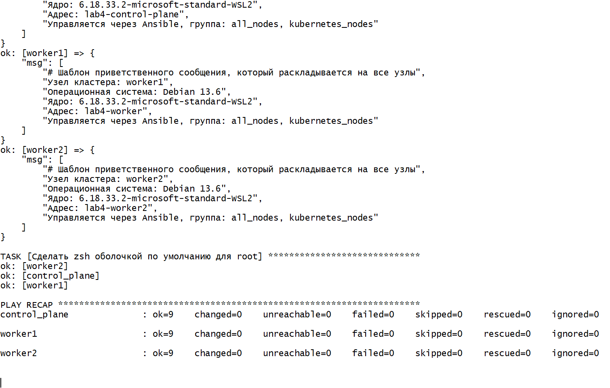
- `images/15-pb-packages.png` — выполнение `playbooks/packages.yml`;

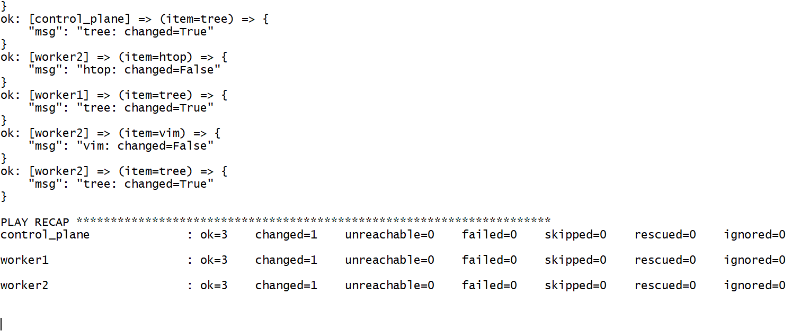
- `images/16-pb-demo.png` — выполнение `playbooks/demo.yml`.

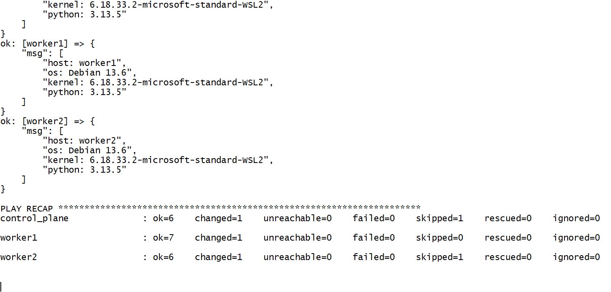

## 5. Ответы на контрольные вопросы

### 1. Для каких задач применяется Ansible?

Ansible применяется для автоматизации управления конфигурациями и развёртывания: установка и обновление пакетов, настройка сервисов и конфигурационных файлов, управление пользователями и правами, развёртывание приложений, оркестрация многошаговых операций, «доведение» серверов до целевого состояния (hardening), управление облачными ресурсами, выполнение задач из CI/CD. Ключевое свойство — идемпотентность: повторный запуск не меняет систему, если она уже в нужном состоянии. Ansible не требует агентов на управляемых узлах (работает по SSH или через плагины подключения).

### 2. Какие способы управления серверами применяются в Ansible?

- **Ad-hoc команды** — однократные команды из CLI (`ansible all -m ping`);
- **Playbooks** — файлы YAML с описанием задач, переменных, обработчиков;
- **Роли** — переиспользуемые структурированные наборы задач;
- **Pull-режим** (`ansible-pull`) — узел сам забирает конфигурацию из репозитория по расписанию;
- **AWX / Red Hat Automation Platform** — веб-интерфейс, API, расписания, учётные данные;
- **Плагины подключения** — `ssh`, `local`, `docker`, `winrm`, `network_cli`;
- **Динамический инвентарь** — получение списка хостов из облака/кластера.

### 3. Что входит в состав файла Ansible playbook?

Playbook — список «пьес» (plays). Каждая пьеса содержит:

- `name` — описание;
- `hosts` — группа или шаблон хостов;
- `become`, `become_user` — повышение привилегий;
- `vars`, `vars_files` — переменные;
- `gather_facts` — сбор фактов;
- `tasks` — список задач: модуль, аргументы, `loop`, `when`, `register`, `notify`, `tags`;
- `handlers` — обработчики, вызываемые по `notify`;
- `roles`, `pre_tasks`, `post_tasks`.

### 4. Что такое группы узлов (хостов) в Ansible?

Группы — именованные наборы хостов в инвентаре, к которым можно обращаться как к единому целому (`hosts: web`). Группы могут вкладываться друг в друга через `[group:children]`, иметь общие переменные (`[group:vars]`, `group_vars/`). В работе определена группа `kubernetes_nodes` из трёх узлов и родительская группа `all_nodes`.

### 5. Как одной командой выполнить ping группы узлов?

```bash
ansible kubernetes_nodes -i inventory.ini -m ping
# или по всем хостам инвентаря
ansible all -i inventory.ini -m ping
```

Результат — `"ping": "pong"` от каждого узла группы (проверено в работе на трёх узлах кластера).

### 6. Что такое роль Ansible?

Роль — способ организовать переиспользуемый набор задач и ресурсов в стандартной структуре каталогов: `tasks/main.yml`, `handlers/main.yml`, `templates/`, `files/`, `defaults/main.yml`, `vars/main.yml`, `meta/main.yml`, `tests/`. Роль подключается в playbook через `roles:` или `include_role`, что позволяет применять одну и ту же конфигурацию (например, `nginx`, `docker`, `common`) к разным проектам. Роли распространяются через `ansible-galaxy`.

### 7. Что такое файл инвентаризации Ansible и как он используется?

Инвентарь — файл (INI или YAML) со списком управляемых хостов, их групп и переменных. Указывается в `ansible.cfg` (`inventory = inventory.ini`), флагом `-i` или по умолчанию `/etc/ansible/hosts`. Для каждого хоста задаются `ansible_host`, `ansible_user`, `ansible_port`, `ansible_connection` и другие переменные. Инвентарь может быть статическим (файл) или динамическим (скрипт/плагин, получающий хосты из облака).

### 8. Что такое специальная команда Ansible (ad-hoc)?

Ad-hoc команда — однократный вызов модуля из командной строки без создания playbook:

```bash
ansible <шаблон_хостов> -m <модуль> -a "<аргументы>"
```

Например, `ansible all -m apt -a "name=zsh state=present"` устанавливает zsh на все узлы. Применяется для быстрых проверок, диагностики и разовых операций; для повторяемых действий используют playbooks.

### 9. Как перезапустить службу с помощью Ansible?

```bash
# ad-hoc
ansible web -m ansible.builtin.service -a "name=nginx state=restarted"

# в playbook
- name: Перезапустить nginx
  ansible.builtin.service:
    name: nginx
    state: restarted
```

Правильный подход — не перезапускать службу при каждом запуске, а делать это через обработчик:

```yaml
- name: Конфигурация nginx
  ansible.builtin.template:
    src: nginx.conf.j2
    dest: /etc/nginx/nginx.conf
  notify: Перезапустить nginx

handlers:
  - name: Перезапустить nginx
    ansible.builtin.service:
      name: nginx
      state: restarted
```

Обработчик выполняется только при изменении конфигурации. В контейнерах kind нет systemd, поэтому в работе обработчик лишь подтверждает изменение (`cat /etc/motd`).

### 10. Что такое HashiCorp Terraform?

Terraform — инструмент Infrastructure as Code от HashiCorp. Описывает инфраструктуру декларативно на языке HCL, строит план изменений, применяет его через API провайдеров и хранит состояние в файле `terraform.tfstate`. Поддерживает сотни провайдеров (AWS, Azure, Google Cloud, Kubernetes, Docker, VMware и др.), работу с модулями, удалённое хранение состояния и блокировки, а также единый рабочий процесс `init → plan → apply → destroy`.

### 11. Что такое инфраструктура как код (Infrastructure as Code — IaC)?

IaC — подход, при котором инфраструктура (серверы, сети, контейнеры, кластеры) описывается в текстовых файлах и управляется так же, как программный код: хранится в Git, проходит code review, версионируется, тестируется и применяется автоматически. Преимущества: воспроизводимость (одинаковое окружение из одного набора файлов), документируемость, откат к предыдущей версии, устранение ручных ошибок, возможность ревью изменений инфраструктуры до применения.

### 12. Как установить Terraform?

Официальные способы:

1. Скачать архив с `releases.hashicorp.com`, распаковать и добавить `terraform` в `PATH`;
2. Пакетные менеджеры: `brew install terraform` (macOS/Linux), `choco install terraform` или `winget install Hashicorp.Terraform` (Windows), репозиторий HashiCorp для `apt`/`yum`;
3. `tfenv` — менеджер версий Terraform;
4. Запуск из официального образа Docker `hashicorp/terraform`.

В данной работе использован вариант 4: сайты HashiCorp недоступны для региона, поэтому CLI запускается из образа `hashicorp/terraform:1.9` (см. п. 2.2). Проверка — `terraform version`.

### 13. Что такое провайдер (поставщик) в Terraform?

Провайдер — плагин, реализующий взаимодействие Terraform с API конкретной платформы (Docker, AWS, Azure, Kubernetes, VMware). Провайдер объявляет ресурсы и источники данных, доступные в конфигурации, и выполняет операции создания/изменения/удаления. Указывается в блоке `required_providers` с адресом источника и версией; бинарник провайдера скачивается при `terraform init`:

```hcl
terraform {
  required_providers {
    docker = {
      source  = "kreuzwerker/docker"
      version = "4.6.0"
    }
  }
}
```

В работе использован провайдер `kreuzwerker/docker` v4.6.0.

### 14. Объясните базовую структуру файла конфигурации Terraform.

Конфигурация состоит из блоков HCL:

| Блок | Назначение |
|---|---|
| `terraform` | версия Terraform, `required_providers`, настройки backend |
| `provider` | параметры подключения к платформе (endpoint, учётные данные, регион) |
| `resource` | объект инфраструктуры: тип и локальное имя (`docker_container.nginx`) |
| `data` | чтение существующих объектов без управления ими |
| `variable` | входные параметры |
| `output` | выходные значения |
| `locals` | вычисляемые локальные значения |
| `module` | подключение переиспользуемого модуля |

Файлы `.tf` в каталоге объединяются в один модуль; имена файлов (`main.tf`, `variables.tf`, `outputs.tf`) — соглашение, а не требование.

### 15. Что такое файл состояния Terraform?

`terraform.tfstate` — JSON-файл, в котором Terraform хранит соответствие между ресурсами конфигурации и реальными объектами инфраструктуры: идентификаторы, атрибуты, зависимости, метаданные провайдера. Состояние позволяет строить корректный план (сравнение «конфигурация ↔ состояние ↔ реальность») и определять, что нужно создать, изменить или удалить. Файл содержит чувствительные данные, поэтому его не коммитят в Git, а хранят в защищённом удалённом backend (S3 + DynamoDB, Terraform Cloud, GitLab) с блокировками и шифрованием.

### 16. Для чего нужна команда terraform destroy?

`terraform destroy` удаляет все ресурсы, описанные в конфигурации и зафиксированные в состоянии, — выполняет обратную операцию к `apply`. Применяется для освобождения ресурсов после лабораторной работы, удаления временных стендов, очистки облачных окружений. Команда показывает план удаления и требует подтверждения (`yes`); флаг `-auto-approve` отключает подтверждение. Аналог — `terraform apply -destroy`. В работе командой `tf destroy` удалены контейнер и образ nginx (2 ресурса).

### 17. Что такое состояние в Terraform?

Состояние (state) — это модель уже созданной инфраструктуры: набор записей о ресурсах с их реальными идентификаторами и атрибутами. Terraform использует состояние как точку отсчёта: при `plan` он обновляет данные о реальных объектах (refresh), сравнивает их с конфигурацией и вычисляет разницу. Если состояние потеряно, Terraform «забывает» о существующих объектах и попытается создать их заново (или потребуется `terraform import`). Изменять состояние вручную нельзя — для этого есть команды `terraform state list`, `state show`, `state mv`, `state rm`.

### 18. Как определить зависимости в Terraform?

- **Неявные зависимости** — через ссылки на атрибуты другого ресурса: `image = docker_image.nginx.image_id` заставляет Terraform создать образ раньше контейнера. Это предпочтительный способ.
- **Явные зависимости** — аргумент `depends_on`, когда связи по атрибутам нет:

```hcl
resource "docker_container" "app" {
  name  = "app"
  image = docker_image.nginx.image_id

  depends_on = [docker_network.lab]
}
```

Terraform строит граф зависимостей и выполняет независимые ресурсы параллельно, а зависимые — строго по порядку. Циклические зависимости недопустимы и приводят к ошибке.

## 6. Вывод

В ходе работы изучены инструменты автоматизации управления инфраструктурой. В задании 1 выполнены все семь руководств трека Terraform «Get Started — Docker»: установлен CLI, описана инфраструктура из образа и контейнера nginx, выполнены `init`, `plan`, `apply`, изменение внешнего порта с пересозданием контейнера, запрос выходных значений и удаление инфраструктуры командой `destroy`; продемонстрирована работа с переменными и файлом состояния. В задании 2 настроен инвентарь из трёх узлов кластера Kubernetes, выполнены ad-hoc команды (`ping`, установка `zsh`), а также три playbook: базовой настройки узлов с шаблоном Jinja2 и обработчиком, установки пакетов циклом и демонстрации переменных, фактов, условий и регистрации результата. Все результаты подтверждены выполнением команд; конфигурационные файлы размещены в каталогах `task1` и `task2` репозитория.
